# Báo cáo kiểm thử flow "Đặt sân" từ website — bốn góc nhìn

**Ngày 2026-10-16 · nhánh `test/flow-dat-san` · kế hoạch gốc: [39](39-ke-hoach-kiem-thu-flow-dat-san.md) · mã nguồn được kiểm: commit `41d0e89`**
(`main` vẫn `83e8f8b` — chưa merge, chưa push, **không đụng bản live trên Render**)

File này **tự đầy đủ**: đọc một mình là đủ. Quy ước kết quả: ✅ đúng · 🐞 lỗi nghiệp vụ · 🔒 bảo mật · 🎨 UI/UX · ❓ cần chủ dự án quyết · ℹ️ ghi nhận.

---

> **Cập nhật sau kế hoạch 41 (nhánh `fix/flow-dat-san-f1-f2-nho`):** F1, F2, F7, F8, F10, F11 **đã sửa**; F9 **ghi nhận có chủ đích, không đổi**; F3, F4, F5, F6 **đã sửa ở kế hoạch 42** ([kết quả](42-ket-qua-sua-flow-dat-san-f3-f6.md)). Chi tiết: [báo cáo kết quả sửa](41-ket-qua-sua-flow-dat-san.md).

---

## Mục lục

1. [Tóm tắt một trang](#1-tóm-tắt-một-trang)
2. [Kết luận theo từng góc nhìn](#2-kết-luận-theo-từng-góc-nhìn)
3. [Phát hiện chi tiết (F1–F11)](#3-phát-hiện-chi-tiết-f1f11)
4. [Câu hỏi cần bạn quyết](#4-câu-hỏi-cần-bạn-quyết)
5. [Những điều đã kiểm và ổn](#5-những-điều-đã-kiểm-và-ổn)
6. [Ảnh chụp](#6-ảnh-chụp)
7. [Bảng từng ca kiểm](#7-bảng-từng-ca-kiểm)
8. [Test hồi quy đã thêm và cách chạy lại](#8-test-hồi-quy-đã-thêm-và-cách-chạy-lại)
9. [Giới hạn: những gì chưa kiểm](#9-giới-hạn-những-gì-chưa-kiểm)
10. [Môi trường tạm](#10-môi-trường-tạm)

---

## 1. Tóm tắt một trang

| Câu hỏi | Trả lời |
|---|---|
| Flow đặt sân chạy được trọn vòng không? | **Có.** Khách vãng lai → chọn ô → đăng nhập → khôi phục lựa chọn → đặt → nhân viên duyệt → mở sân từ booking → checkout → booking `completed` → quản lý/admin thấy doanh thu và nhật ký: đủ 11 bước, đúng ở cả API lẫn giao diện thật. |
| Có lỗ hổng nghiêm trọng (🔴) không? | **Không.** Không có cách nào để khách xem/sửa/huỷ booking của người khác, không vượt chi nhánh, không tự nâng trạng thái, không chèn script qua tên khách. |
| Có đặt trùng/chồng giờ được không? | **Không.** Hai yêu cầu song song cùng khung: đúng 1×201 + 1×409 (cả khi cùng khách lẫn hai khách); DB sau toàn bộ kịch bản: 0 cặp chồng giờ. |
| Có sai tiền không? | Không thấy. Doanh thu CN tăng đúng bằng hoá đơn, hoàn về mức cũ sau khi huỷ hoá đơn; admin (chọn CN) và quản lý cùng thấy một số. |
| Tìm được gì? | **11 phát hiện**: 3 cái 🟠 nên sửa (F3, F4, F6), 3 cái 🟡 (F1, F2, F5), 5 cái nhỏ về trải nghiệm/ghi nhận (F7–F11). Không có 🔴. |
| Sửa chưa? | **Chưa — theo quyết định của bạn (Q3): chỉ ghi báo cáo.** Hai lỗi chắc chắn (F1, F2) đã có test `test.failing` để khi sửa xong sẽ tự báo. |
| Test hồi quy | **+31 test** vào `backend/tests-security/booking-flow.security.test.js`, 31/31 pass, chạy lại 2 lần liên tiếp đều pass. |
| Quy mô kiểm | **150 ca** (128 ca API/DB + 22 ca giao diện thật bằng Chrome headless, laptop 1366×768 và điện thoại 390×844), 26 ảnh chụp. |

**Bảng đếm kết quả 150 ca:**

| Kết quả | Số ca |
|---|---|
| ✅ đúng | 116 |
| ℹ️ ghi nhận / thông tin | 19 |
| 🐞 lỗi nghiệp vụ (4 ca → F1, F2) | 4 |
| 🔒 bảo mật (→ F3) | 1 |
| 🎨 UI/UX (→ F6, F8) | 5 |
| ❓ cần bạn quyết (→ F3, F4, F5, F9) | 5 |
| **Tổng** | **150** (128 ca API/DB + 22 ca giao diện) |

> Một số ca đầu bị đánh dấu 🐞 trong lần chạy thô nhưng hoá ra là kỳ vọng sai của kịch bản (checkout lặp là idempotent đúng thiết kế; hoá đơn "trùng" là dữ liệu seed). Báo cáo đã **sửa lại kết luận** ở các ca đó và ghi rõ lý do trong cột bằng chứng — xem C27, H1, D5, E4/E5, H2d, G5.

---

## 2. Kết luận theo từng góc nhìn

### 2.1 Khách vãng lai (chưa đăng nhập)
- Xem được lưới ngày của mọi chi nhánh, **không lộ** tên/SĐT/email/userId của ai; phản hồi `Cache-Control: no-store`; tham số ngày/chi nhánh sai đều trả 4xx.
- Không token / token rác → `POST /bookings`, `GET /bookings`, `GET /bookings/availability` đều **401** (chỉ `/public/*` công khai).
- Chọn ô → "Đăng nhập để đặt" → `/login` → đăng nhập → quay về `/dat-san`, **khôi phục đúng sân/giờ** và mở hộp xác nhận. Chạy đúng cả trên điện thoại.

### 2.2 Khách (customer)
- Đặt hợp lệ → `pending`, gắn đúng khách và chi nhánh. Gửi kèm `status/customerId/createdBy/branchId/totalAmount` → **bị bỏ qua**.
- Giới hạn đúng: 1–3 giờ được; 3,5 và 6 giờ → 400; hôm nay+13 → 201, hôm nay+14 → 400; ngày đã qua, trước 05:00, quá 23:00, giờ/ngày/courtId sai → 4xx (không có 5xx).
- Xung đột: khung bị người khác đặt trong lúc hộp xác nhận đang mở → server 409, giao diện **đóng hộp, cập nhật ô thành "đã kín", hiện dòng "Khung giờ này đã có người đặt…"**, không treo, không tạo booking.
- Khách không sửa giờ, không tự xác nhận, không xem/huỷ booking của người khác (403); huỷ của mình → 200, huỷ lại → 400; khung vừa huỷ được người khác đặt ngay.
- ⚠️ **F3**: một tài khoản khách tạo được **60 booking `pending` liên tiếp** trong vài giây (không có trần số lượng, không giới hạn tần suất, không hết hạn).

### 2.3 Nhân viên (employee)
- Chỉ thấy booking của chi nhánh mình; nhân viên CN2 không xác nhận/xem được booking CN1 (403/404); không mở sân CN2 bằng booking của CN1.
- Đặt hộ khách vãng lai (tên + SĐT) tạo hồ sơ khách; không bị giới hạn 14 ngày / 3 giờ (đúng thiết kế cho giải đấu).
- Xác nhận chỉ từ `pending`; sửa giờ đúng; sửa kèm trường cấm → 400; sửa sang ngày đã qua → 400; huỷ hộ → 200.
- Mở sân từ booking → checkout → booking `completed`; booking `completed` không huỷ/sửa được; checkout lặp **idempotent** (trả lại hoá đơn cũ, DB 1 hoá đơn/phiên).
- ⚠️ **F1, F2, F4, F5, F6** nằm ở vai trò này (xem §3).

### 2.4 Quản lý chi nhánh (branch_manager)
- Chỉ thấy/đụng chi nhánh mình; `X-Branch-Id` chi nhánh khác → 403; không xác nhận được booking CN khác.
- Báo cáo doanh thu CN tăng đúng bằng hoá đơn (143.000đ cho phiên 90 phút), xuất Excel 200, dashboard 200; nhân viên (không phải quản lý) → 403 khi xem báo cáo/nhật ký/huỷ hoá đơn.
- Huỷ hoá đơn → doanh thu về đúng mức trước checkout. Nhật ký có `booking.created/confirmed/cancelled`, `court.session_opened`, `payment.completed`, `invoice.voided`, kèm người thực hiện; **không chứa** mật khẩu/token/hash.

### 2.5 Admin
- Không chọn chi nhánh: danh sách mặc định CN1; chọn `X-Branch-Id=3` → chỉ booking CN3; `X-Branch-Id` không tồn tại → 403.
- Chọn CN rồi đặt hộ/xác nhận/huỷ ở CN bất kỳ → 201/200/200. Nhật ký hiển thị nhiều chi nhánh, nhiều người thực hiện.
- ⚠️ **F8**: chưa chọn chi nhánh thì thông báo lỗi không gợi ý "hãy chọn chi nhánh".

---

## 3. Phát hiện chi tiết (F1–F11)

Mức: 🟠 nên sửa · 🟡 ghi nhận, sửa khi tiện · 🟢 nhỏ. Không có 🔴.

### F1 🐞 🟡 — `GET /bookings?date=abc` trả **500** — **✅ đã sửa**
- **Tái hiện:** nhân viên gọi `GET /api/v1/bookings?date=abc` → `500 Lỗi máy chủ nội bộ`; log: `SequelizeDatabaseError ER_WRONG_VALUE: Incorrect DATE value: 'Invalid date'`.
- **Nguyên nhân:** `BookingService.getAllBookings` đưa thẳng `query.date` vào `where.bookingDate` (không có rule validate cho query như `createBookingRules`). `status=` lạ trả 200 danh sách rỗng; `courtId=abc` trả 200 (bị bỏ qua).
- **Tác động:** thấp — chỉ nhân viên gọi được, thông điệp 500 đã được errorHandler che (không lộ SQL). Nhưng là 5xx do đầu vào người dùng.
- **Gợi ý:** thêm `query('date').optional().isISO8601()` (và `courtId` `isInt`, `status` `isIn`) vào validator của `GET /bookings`, trả 400.
- **Test:** `test.failing` "danh sách đặt sân với date không hợp lệ phải trả 400".

### F2 🐞 🟡 — Đặt hộ: SĐT không được kiểm như lúc tự đăng ký — **✅ đã sửa**
- **Tái hiện (nhân viên `POST /bookings` kèm `customerName` + `customerPhone`):**
  `"123"` → **201, lưu phone = `123`** · `"abc"` → **201, phone = NULL** (im lặng) · `"+84 919 000 333"` → 201, chuẩn hoá thành `0919000333` (tốt) · chuỗi 23 ký tự → 400.
  Trong khi tự đăng ký với `"abc"` → 400.
- **Tác động:** SĐT là khoá nhận diện khách xuyên chi nhánh (đã gộp hồ sơ theo SĐT, migration `20260815300001`). Hồ sơ phone `123`/NULL không khớp được khi khách đăng ký thật → lịch sử nằm rời; mỗi lần đặt với `"abc"` có thể sinh thêm hồ sơ không SĐT.
- **Gợi ý:** dùng cùng bộ chuẩn hoá/validator SĐT của `auth/register` cho `customerPhone` ở `POST /bookings` (và `POST /customers`); từ chối khi không hợp lệ.
- **Test:** `test.failing` "đặt hộ với SĐT không hợp lệ phải bị từ chối".

### F3 🔒 🟠 — Không giới hạn số booking `pending` / không hết hạn → chiếm chỗ hàng loạt — **✅ đã sửa (kế hoạch 42)**
- **Tái hiện:** một tài khoản khách vừa đăng ký, vòng lặp `POST /bookings` qua mọi sân CN1–CN3 × 4 ngày × 6 khung 1 giờ → **60 lần 201 liên tiếp** (6 lần dừng chỉ vì sân bảo trì); không 429. Toàn bộ khung đó biến thành "đã kín" trên lưới công khai cho người khác.
- **Vì sao đáng kể:** trần 3 giờ/lượt và 14 ngày chặn *một* lượt, không chặn *số lượt*; `pending` không có hạn tự huỷ (kiểm DB: không có job dọn) nên chỉ nhân viên huỷ tay mới nhả chỗ. Một kẻ phá hoại hoặc một khách vô ý có thể làm trống lịch cả chuỗi. `POST /bookings` không có rate limiter riêng.
- **Gợi ý (cần bạn chọn mức, xem §4 Q1–Q2):** (a) trần số booking `pending/confirmed` còn hiệu lực mỗi khách (vd 5–10); (b) tự huỷ `pending` quá N giờ chưa duyệt hoặc cách giờ chơi < M phút; (c) rate limit `POST /bookings` theo user/IP.

### F4 ❓ 🟠 — Mở sân từ booking **không kiểm ngày/giờ** của booking — **✅ đã sửa (kế hoạch 42)**
- **Tái hiện:** nhân viên tạo booking ngày **hôm nay+20**, rồi `POST /courts/:id/open {bookingId}` ngay hôm nay → **201**; checkout → booking thành `completed`, khung của ngày +20 trở lại **trống** cho người khác đặt.
- **Tác động:** mở nhầm booking (chọn nhầm dòng trong danh sách, nhất là khi một khách có nhiều lịch) làm "ăn" mất lịch tương lai của họ mà không cảnh báo. Mã chỉ kiểm: booking pending/confirmed, cùng sân, cùng chi nhánh.
- **Gợi ý:** chỉ cho mở khi `bookingDate` = hôm nay theo múi giờ chi nhánh (và có thể trong ±X phút quanh giờ bắt đầu), nếu không trả 400 kèm lý do; hoặc cho phép nhưng bắt nhân viên xác nhận rõ ràng.

### F5 ❓ 🟡 — Đặt hộ bằng SĐT trùng khách có sẵn: **tên nhập bị bỏ qua, không cảnh báo** — **✅ đã sửa (kế hoạch 42)**
- **Tái hiện:** nhân viên đặt hộ tên "Kẻ Mạo Danh", SĐT `0903333333` → 201, booking gắn vào hồ sơ **Nguyễn Văn Khách** (đúng thiết kế: SĐT là khoá). Hồ sơ không bị đổi tên (✅). Tên đã nhập không xuất hiện ở đâu.
- **Tác động:** gõ nhầm một số điện thoại → booking nằm trong "Lịch của tôi" của một người lạ (họ có thể huỷ), nhân viên không biết. Ở giao diện: form đóng như thường.
- **Gợi ý:** phản hồi trả thêm tên khách khớp và giao diện hiện "Đã gắn vào khách *Nguyễn Văn Khách* (khớp SĐT)"; cảnh báo khi tên nhập khác tên lưu.

### F6 🎨 🟠 — Trang **Quản lý đặt sân của nhân viên không tự cập nhật** — **✅ đã sửa (kế hoạch 42)**
- **Tái hiện:** nhân viên mở `/bookings`; khách đặt mới qua website; chờ 8 giây → **không xuất hiện** (phải tải lại trang).
- **Nguyên nhân:** SSE `/realtime/stream` chỉ phát `court:updated` (đọc `realtimeController.js`); `BookingService` không phát sự kiện nào; trang không polling. (Trang `/dat-san` của khách thì tự tải lại mỗi 30 giây.)
- **Tác động:** vận hành — yêu cầu đặt sân `pending` của khách nằm đó tới khi nhân viên tình cờ tải lại; khách chờ "nhân viên sẽ duyệt trước giờ chơi".
- **Gợi ý:** phát `booking:changed` qua `realtimeBus` và để trang đăng ký (cơ chế đã có cho sân), hoặc polling 30 s như `/dat-san`; kèm chấm/huy hiệu số booking `pending`.

### F7 🎨 🟢 — Lỗi ở form nhân viên hiện bằng `alert()` của trình duyệt — **✅ đã sửa (luồng đặt sân)**
Ví dụ 409 "Khung giờ này đã có người đặt…" bật hộp thoại gốc; trang khách thì dùng banner đẹp. Đồng bộ lại cho nhất quán.

### F8 🎨 🟢 — Admin chưa chọn chi nhánh: thông báo mơ hồ — **✅ đã sửa (câu chữ)**
`POST /bookings` sân CN3 → `404 "Court not found"`; đọc booking CN3 theo id → `403 "Booking không thuộc chi nhánh hiện tại"`. Đúng về phân quyền nhưng nên nói "Hãy chọn chi nhánh trước" / hoặc tự suy chi nhánh từ sân khi là admin.

### F9 ❓ 🟢 — Booking vẫn `completed` sau khi **huỷ hoá đơn** — **ℹ️ giữ nguyên có chủ đích**
Huỷ hoá đơn hoàn doanh thu đúng, phiên ở `closed`, nhưng booking giữ `completed`, khách vẫn thấy "hoàn thành" dù đã hoàn tiền. Nếu muốn: trạng thái/ghi chú riêng "hoá đơn đã huỷ" hoặc mở lại khung.

### F10 🎨 🟢 — "Lịch đặt của tôi" trộn lịch đã huỷ với lịch còn hiệu lực — **✅ đã sửa**
Sắp tăng dần theo ngày, các lịch `ĐÃ HUỶ` chen giữa (tài khoản demo sau kiểm có nhiều chục dòng). Gợi ý tab/bộ lọc "Sắp tới / Đã huỷ" hoặc đưa lịch đã huỷ xuống cuối.

### F11 🎨 🟢 — Điện thoại: thanh tóm tắt bị cắt chữ, nút cuộn-lên chạm mép thanh — **✅ đã sửa**
Dòng phụ "Sân số 1 · T6 16/10 · 1…" bị cắt ở 390 px; nút mũi tên cuộn-lên nằm sát phải thanh tóm tắt. Không che nút chính, không cuộn ngang (`scrollWidth` = 390).

---

## 4. Câu hỏi cần bạn quyết

| # | Câu hỏi | Gợi ý mặc định |
|---|---|---|
| **Q1** | Mỗi khách được giữ tối đa bao nhiêu booking chưa chơi (`pending`+`confirmed`) cùng lúc? (F3) | 5 cho khách; không giới hạn cho nhân viên |
| **Q2** | `pending` quá bao lâu thì tự huỷ? (F3) | tự huỷ khi còn < 60 phút tới giờ chơi mà chưa duyệt, hoặc sau 24 giờ — tuỳ cách bạn vận hành |
| **Q3** | Có thêm rate limit riêng cho `POST /bookings` không? (F3) | 20 lượt / 10 phút / user |
| **Q4** | Mở sân từ booking: chặn cứng ngoài ngày hôm nay, hay chỉ cảnh báo? (F4) | chặn cứng nếu khác ngày; cho nhân viên xác nhận khi lệch giờ |
| **Q5** | Khi đặt hộ trùng SĐT khách có sẵn, hiển thị tên khớp + cảnh báo khi tên khác? (F5) | Có |
| **Q6** | Trang nhân viên tự cập nhật bằng SSE hay polling? (F6) | SSE, vì hạ tầng đã có |
| **Q7** | Booking có hoá đơn bị huỷ: giữ `completed` hay trạng thái riêng? (F9) | trạng thái/ghi chú riêng |
| **Q8** | Sửa F1, F2 và các mục 🟢 ngay (nhỏ, một nhánh `fix/…`) rồi mới merge? | Có — làm một nhánh duy nhất, kèm đổi 2 `test.failing` thành `test` |

---

## 5. Những điều đã kiểm và ổn

- **Phân quyền:** 25+ ca chéo vai trò/chi nhánh đều bị chặn đúng (khách ↔ khách, nhân viên ↔ chi nhánh khác, quản lý ↔ chi nhánh khác, nhân viên ↔ báo cáo/nhật ký/huỷ hoá đơn, khách ↔ trang nhân viên bằng URL → bị chuyển về `/my-bookings`, nhân viên gõ `/reports` → bị chuyển về `/courts`).
- **Toàn vẹn dữ liệu:** 0 cặp booking hiệu lực chồng giờ; 0 booking mồ côi; không có hoá đơn/thanh toán trùng theo phiên.
- **Đồng thời:** bấm đúp, hai khách tranh một khung, thử lại 3 lần cùng yêu cầu → đúng 1 booking.
- **Nhất quán:** lưới công khai ↔ `/bookings/availability` khớp ở 6/6 ô mẫu; sân bảo trì bị chặn ở lưới (`maintenance`), ở đặt của khách và cả ở đặt hộ của nhân viên.
- **Múi giờ:** `bookingDate` trả đúng ngày đã chọn, ranh giới "hôm nay+13/+14" tính theo lịch chi nhánh.
- **XSS:** tên khách `Khách XSS` lưu nguyên văn dạng chuỗi và hiển thị như chữ trong danh sách nhân viên: 0 hộp thoại `alert` bị kích hoạt, không có thẻ `` chèn vào DOM, 0 lỗi console.
- **Lộ dữ liệu:** phản hồi lưới công khai, danh sách của khách, nhật ký, SSE: không chứa PII/hash/token; SSE không phát chi tiết booking (và vì thế mới có F6).
- **Hiệu năng cơ bản:** 120 request `GET /bookings` đồng thời trong < 1 giây, đều 200.
- **Giao diện:** hộp xác nhận có focus trap, nút "Quay lại"; điện thoại không cuộn ngang; hộp xác nhận nằm gọn màn hình 390 px.

---

## 6. Ảnh chụp

Thư mục: `docs/05-extra/02-remediation/40-anh/` (1366×768 trừ khi ghi *điện thoại*).

| Ảnh | Nội dung |
|---|---|
| 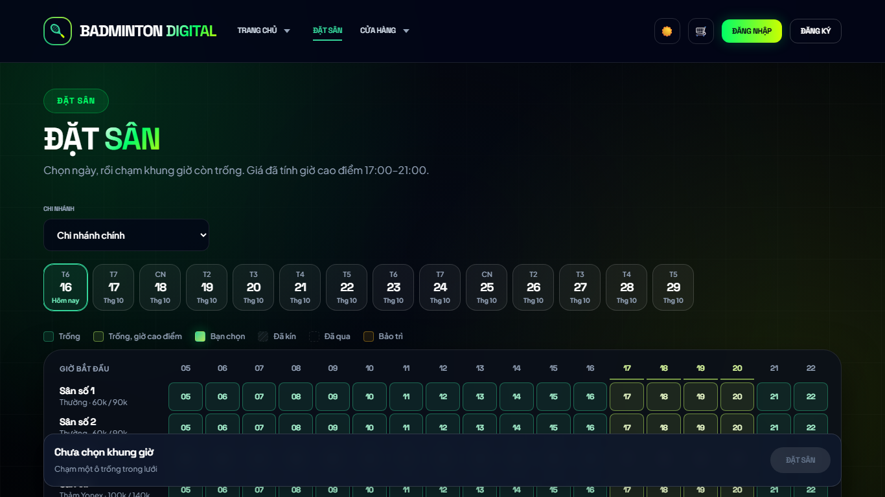 | **U1.1** Khách vãng lai xem lưới ngày |
| 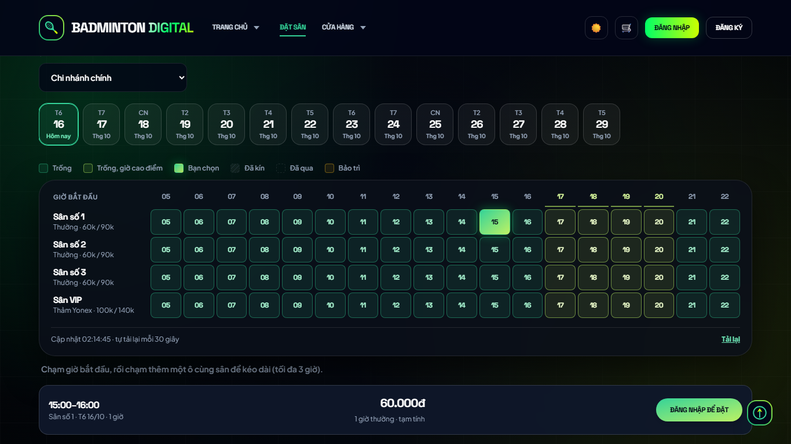 | **U1.2** Chọn ô → thanh tóm tắt |
| 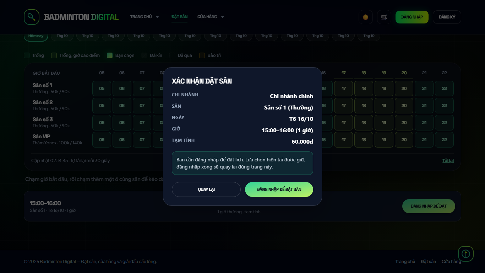 | **U1.3a** Hộp xác nhận cho khách vãng lai ("Đăng nhập để đặt sân") |
| 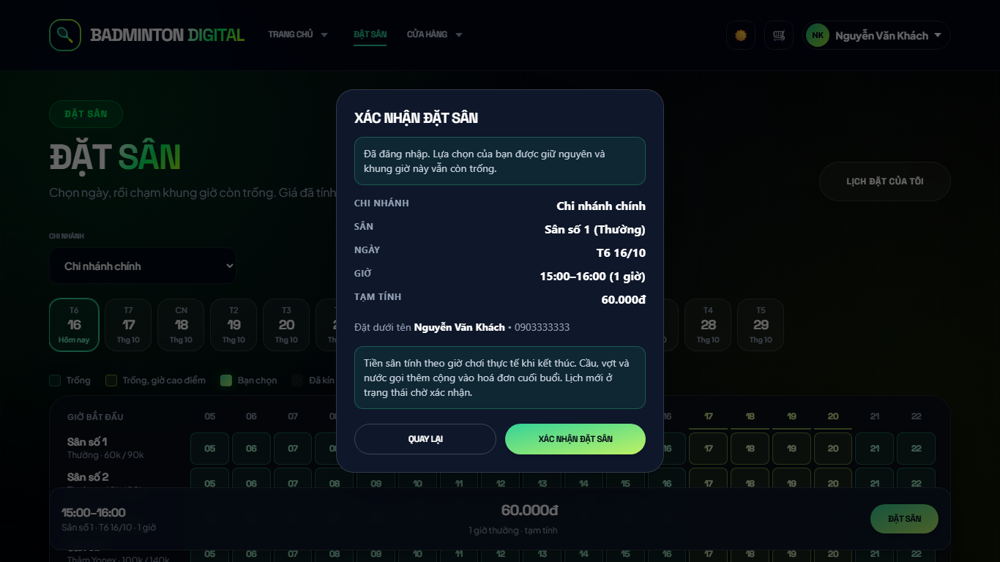 | **U1.4** Sau đăng nhập: quay lại, khôi phục lựa chọn |
| 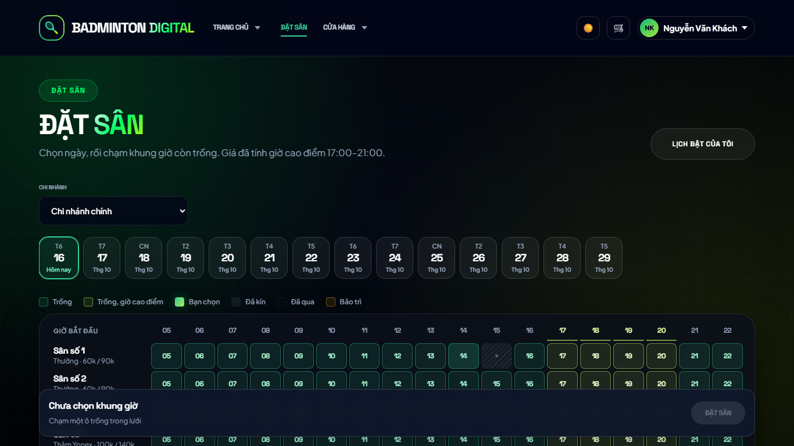 | **U1.5** Xung đột 409: ô thành "đã kín" + dòng báo |
| 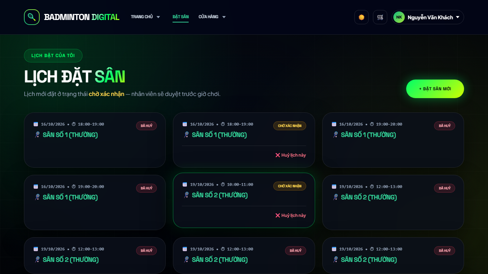 | **U1.6** Đặt xong → "Lịch đặt của tôi" (chờ xác nhận) |
| 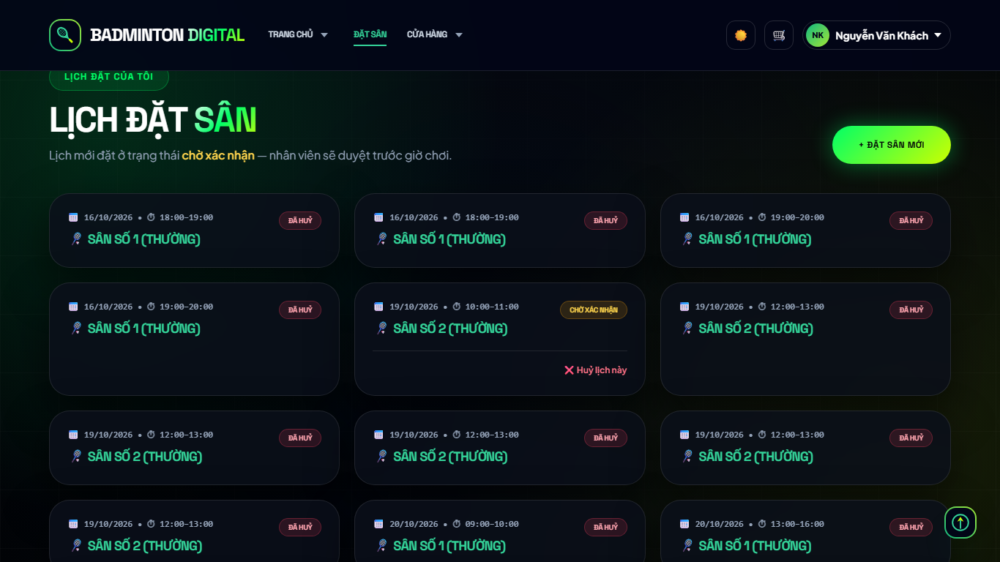 | **U1.7** Sau khi huỷ lịch |
| 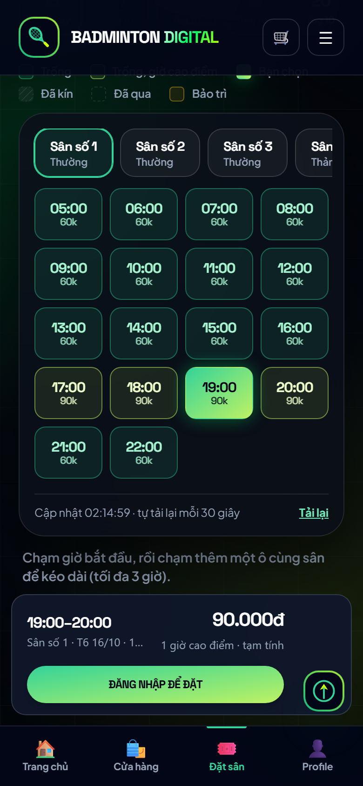 | **U2.2** *Điện thoại* — chọn ô, thanh tóm tắt |
| 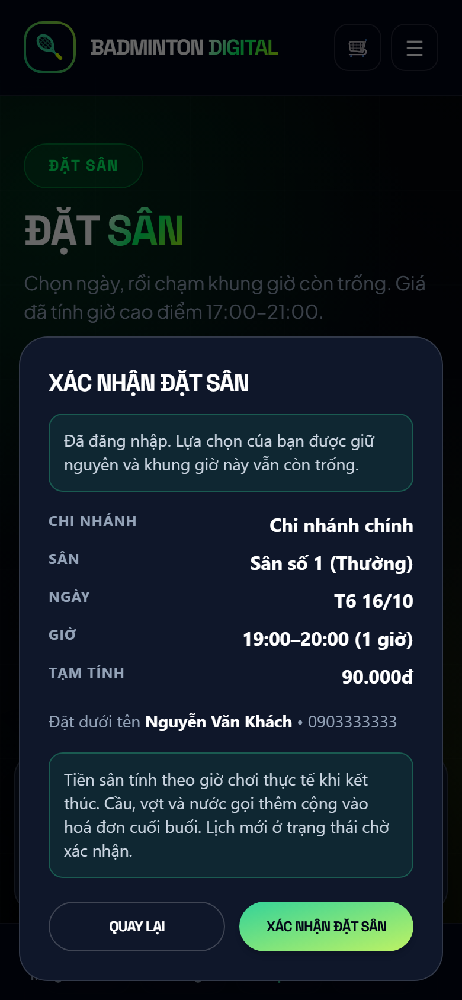 | **U2.3** *Điện thoại* — hộp xác nhận |
| 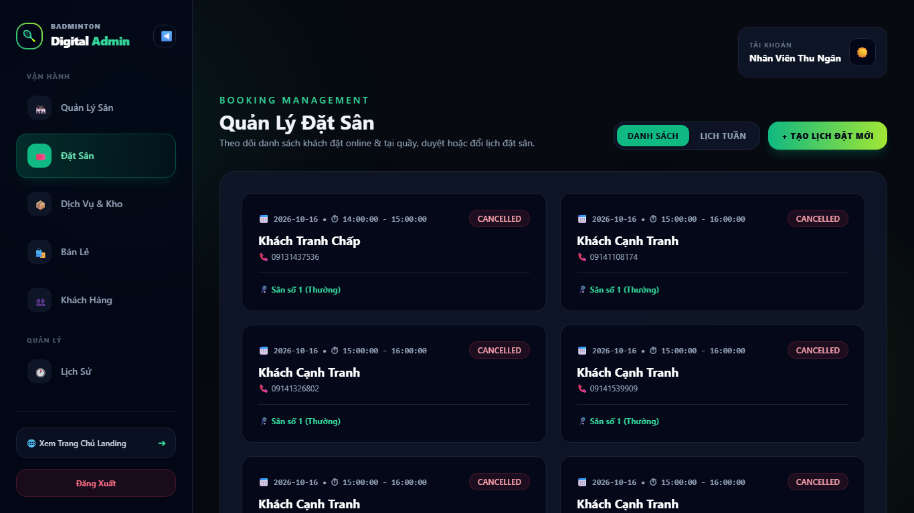 | **U3.1** Nhân viên — Quản lý đặt sân |
| 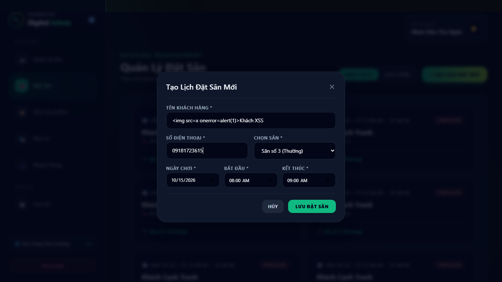 | **U3.4** Nhân viên — form tạo lịch (tên chứa HTML) |
| 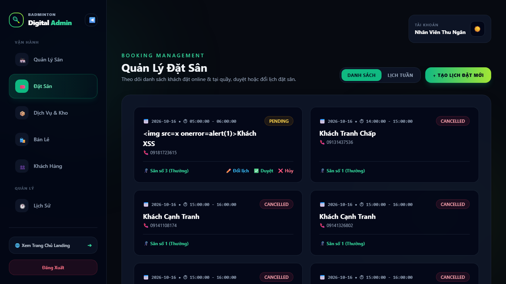 | **U3.4b** Sau khi tạo — tên hiển thị dạng chữ |
| 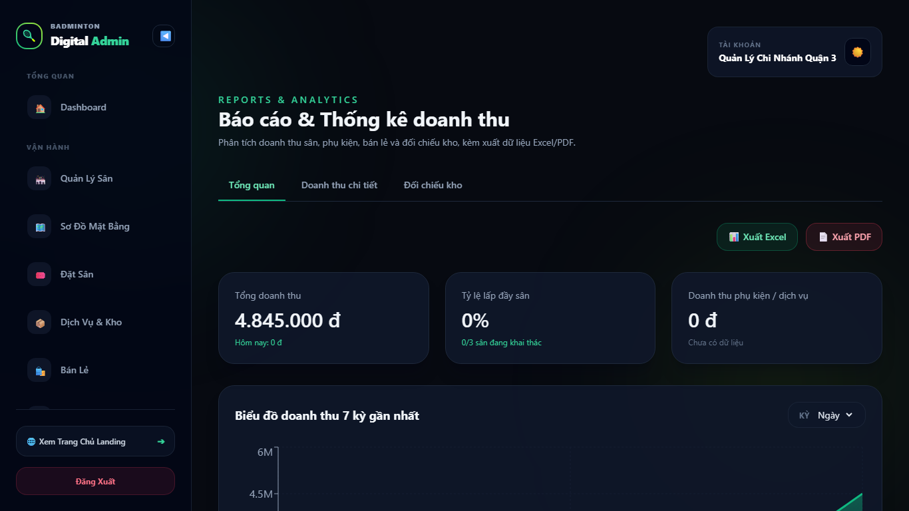 | **U4.1** Quản lý — báo cáo |
| 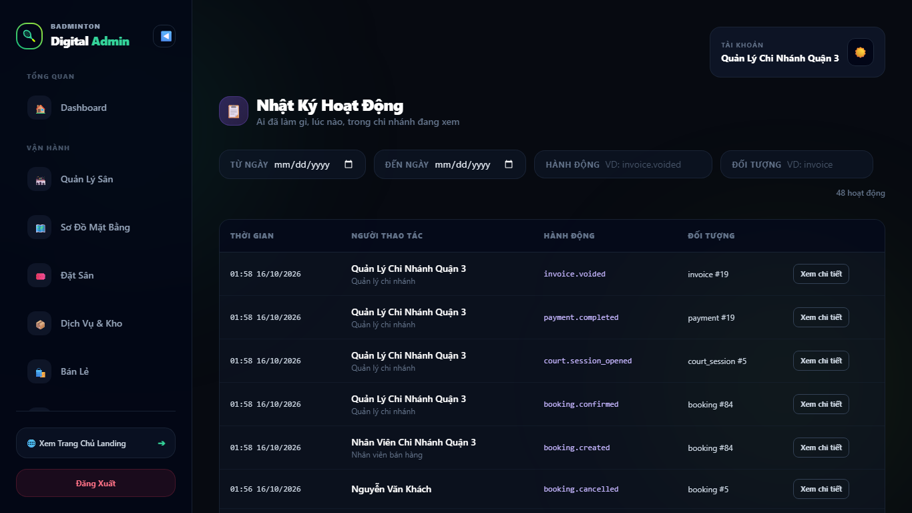 | **U4.1** Quản lý — nhật ký hoạt động |
| 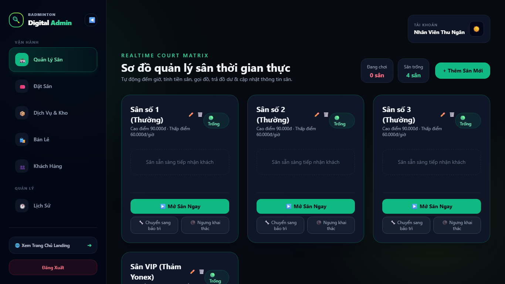 | **U4.2** Nhân viên gõ `/reports` → bị chuyển đi |
| 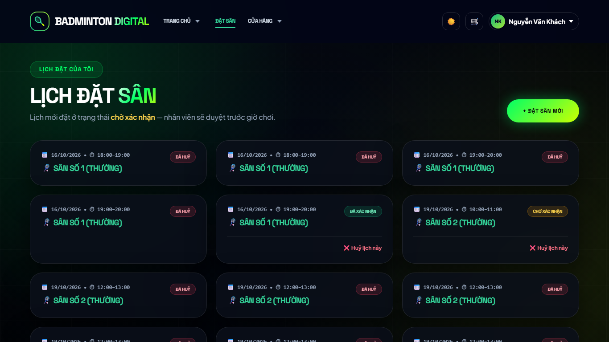 | **U4.3** Khách gõ `/bookings` → bị chuyển đi |
| 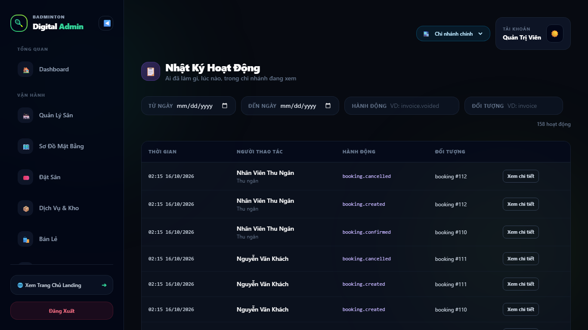 | **U4.4** Admin — nhật ký |

Các ảnh còn lại trong thư mục (`u1-3`, `u1-7`, `u2-1`, `u2-4`, `u3-2`, `u3-5`, `u3-6`, `u4-1`, `u4-6`) là các bước trung gian của cùng kịch bản.

---

## 7. Bảng từng ca kiểm

Mã: **A** vãng lai · **B** khách · **C** nhân viên · **D** quản lý · **E** admin · **F** đường vàng xuyên vai trò · **G** kiểm chéo/lạm dụng · **H** điều tra sâu (vòng 2) · **U** giao diện thật.

#### A. Khách vãng lai (chưa đăng nhập)

| Mã | Nội dung kiểm | KQ | Bằng chứng |
|---|---|---|---|
| A1 | GET /public/branches công khai, có danh sách chi nhánh | ✅ | 200, 3 chi nhánh |
| A2 | Lưới ngày công khai: có đủ sân/ô, không lộ thông tin khách | ✅ | 200, 5120 byte |
| A3 | Lưới ngày công khai: Cache-Control no-store (không lưu cache trạng thái ô) | ✅ | no-store |
| A4 | POST /bookings không token → 401 | ✅ | 401 |
| A5 | GET /bookings không token → 401 | ✅ | 401 |
| A6 | POST /bookings token rác → 401 | ✅ | 401 |
| A7 | GET /bookings/availability không token → 401 (chỉ /public/* công khai) | ✅ | 401 |
| A8 | Tham số ngày/chi nhánh sai hoặc ngoài dải: không 5xx | ✅ | 400,400,400,400,404,400,400 |
| A9 | Lưới ngày +40 (ngoài dải 14 ngày): trả 400 | ℹ️ | 400 null |

#### B. Khách (customer)

| Mã | Nội dung kiểm | KQ | Bằng chứng |
|---|---|---|---|
| B1 | Đặt 1 giờ hợp lệ → 201, trạng thái pending, gắn đúng khách và chi nhánh | ✅ | 201 {"version":0,"id":1,"courtId":1,"branchId":1,"customerId":1,"bookingDate":"2026-10-20","startTime":"09:00","endTime":"10:00","status":"pending","createdBy":3,"u |
| B2 | bookingDate trả về đúng ngày đã chọn (không lệch múi giờ) | ✅ | 2026-10-20 |
| B3 | Phản hồi đặt sân của khách không lộ email nhân viên/hash/token | ✅ | {"version":0,"id":1,"courtId":1,"branchId":1,"customerId":1,"bookingDate":"2026-10-20","startTime":"09:00","endTime":"10 |
| B4 | Sau khi đặt: lưới công khai thấy ô đó là "booked" | ✅ | 200 |
| B5 | GET /bookings/availability cho cùng khung: không còn trống | ✅ | {"available":false,"reason":"ALREADY_BOOKED","message":"Khung giờ này đã có người đặt, vui lòng chọn khung giờ khác","co |
| B6 | Đặt lại đúng khung đó (cùng khách / khách khác) → 409 | ✅ | 409, 409 |
| B7 | Chồng một phần (09:30–10:30) → 409 | ✅ | 409 |
| B8 | Sát nhau (10:00–11:00 liền sau 09:00–10:00) → 201 | ✅ | 201 |
| B9 | Đặt đúng 3 giờ → 201 | ✅ | 201 |
| B10 | Quá 3 giờ (3,5 giờ và 6 giờ) → 400 kèm thông điệp rõ | ✅ | 400,400 |
| B11 | Ranh giới 14 ngày: hôm nay+13 → 201, hôm nay+14 → 400 | ✅ | 201, 400 |
| B12 | Ngày đã qua → 400 | ✅ | 400 Khung giờ này đã qua, vui lòng chọn khung giờ khác |
| B13 | Đầu vào sai/ngoài giờ: toàn bộ 4xx, không 5xx | ✅ | giờ kết thúc ≤ giờ bắt đầu=400 | trước 05:00=400 | qua 23:00=400 | courtId không tồn tại=404 | courtId chữ=400 | courtId âm=400 | ngày sai=400 | giờ sai=400 | thiếu trường=400 |
| B14 | Không có sân bảo trì trong dữ liệu mẫu — bỏ qua | ℹ️ | Dữ liệu mẫu có sân bảo trì (#10, CN3) nhưng khách ở CN1 không thấy qua /public/courts của CN1 — đã kiểm ở H2b. |
| B15 | Khách đặt ở chi nhánh khác (chọn sân CN2) → 201, branchId = 2 | ✅ | 201 branch=2 |
| B16 | Khách gửi X-Branch-Id → 403 | ✅ | 403 |
| B17 | Gửi kèm status/customerId/createdBy/branchId: bị bỏ qua (pending, của chính khách, đúng chi nhánh) | ✅ | 201 {"version":0,"id":6,"courtId":1,"branchId":1,"customerId":1,"bookingDate":"2026-10-22","startTime":"09:00","endTime":"10:00","status":"pendi |
| B18 | Bấm hai lần song song: đúng 1×201 + 1×409 | ✅ | 201,409 |
| B19 | Hai khách tranh một khung: đúng 1 người được, người kia 409 | ✅ | 201,409 |
| B20 | "Lịch của tôi" chỉ có booking của chính mình | ✅ | 7 dòng, 0 lạ |
| B21 | Xem booking của khách khác → 403 | ✅ | 403 |
| B22 | Khách sửa giờ / tự xác nhận → 403 | ✅ | 403, 403 |
| B23 | Huỷ booking của khách khác → 403 và booking còn nguyên | ✅ | 403 |
| B24 | Huỷ booking của chính mình → 200, trạng thái cancelled | ✅ | 200 cancelled |
| B25 | Huỷ lần hai → 400 | ✅ | 400 |
| B26 | Sau khi huỷ: khung đó đặt lại được ngay bởi người khác | ✅ | 201 |
| B27 | Giữ chỗ hàng loạt: một khách tạo được 60 booking pending liên tiếp (không có trần/giới hạn tần suất?) | 🔒 | 60 thành công, 6 bị chặn; lý do đầu: 400 Sân đang bảo trì, không nhận đặt lịch mới cho tới khi hoàn tất |
| B28 | Booking pending có tự hết hạn không? (đọc mã: không có job dọn booking quá hạn xác nhận) | ❓ | pending > 1 ngày tuổi: 0. Chưa có quy định thời hạn giữ chỗ khi chưa xác nhận. |

#### C. Nhân viên (employee)

| Mã | Nội dung kiểm | KQ | Bằng chứng |
|---|---|---|---|
| C1 | Nhân viên CN1 thấy booking của khách và chỉ thuộc chi nhánh 1 | ✅ | 38 dòng; khác CN: 0 |
| C2 | Danh sách có tên + SĐT khách (nhân viên cần để vận hành) | ✅ | {"id":1,"fullName":"Nguyễn Văn Khách","phone":"0903333333"} |
| C3 | Nhân viên CN2 xem booking CN1 theo id → 403/404 | ✅ | 403 |
| C4 | Đặt hộ khách vãng lai (tên + SĐT) → 201, tạo hồ sơ khách | ✅ | 201 customerId=4 createdBy=2 |
| C5 | Đặt hộ bằng SĐT của khách đã có tài khoản: không đổi tên/hồ sơ của khách đó | ✅ | booking.customerId=1 (khách demo=1); tên: "Nguyễn Văn Khách" → "Nguyễn Văn Khách" |
| C6 | Đặt hộ bằng SĐT của khách có tài khoản gắn booking vào: CHÍNH khách đó (khách thấy booking này trong "Lịch của tôi") | ❓ | 201 |
| C7 | Nhân viên đặt xa 30 ngày và 6 giờ liền → 201 (không bị giới hạn như khách) | ✅ | 201 |
| C8 | SĐT các dạng lạ khi đặt hộ | 🐞 | abc=201 | 123=201 | 09190001112222222222222=400 | +84 919 000 333=201 |
| C9 | Tên khách chứa HTML: lưu nguyên văn dạng chuỗi (hiển thị an toàn kiểm ở giao diện) | ✅ | 201 |
| C10 | Xác nhận pending → confirmed | ✅ | 200 confirmed |
| C11 | Xác nhận lần hai → 400 | ✅ | 400 |
| C12 | Nhân viên CN2 xác nhận booking CN1 → 403/404 | ✅ | 404 |
| C13 | Sửa giờ sang khung trống → 200 | ✅ | 200 15:00 |
| C14 | Sửa sang khung đã có người (13:00 2026-10-21 sân 1) | ℹ️ | 200 Booking updated successfully |
| C15 | Sửa sang ngày đã qua → 400 | ✅ | 400 Khung giờ này đã qua, vui lòng chọn khung giờ khác |
| C17 | Sửa kèm trường cấm (status/customerId/branchId) → 400, DB không đổi | ✅ | 400 Không sửa được các trường: status, customerId, branchId |
| C18 | Lọc theo ngày/sân/trạng thái đúng; tham số lạ không 5xx | 🐞 | lọc=200, lạ=500,200,200 |
| C19 | Nhân viên huỷ hộ → 200 cancelled | ✅ | 200 |
| C20 | Tạo booking hôm nay 20:00–21:00 cho luồng mở sân (hiện 01:55:49) | ℹ️ | 201 |
| C21 | Mở sân từ booking → 201, có phiên đang chơi | ✅ | 201 session=1 |
| C22 | Mở sân từ booking của 30 ngày sau (hôm nay chưa tới ngày): trả 201 | ❓ | 201 Court opened successfully |
| C23 | Mở sân (CN2) bằng booking của CN1 → 400/404 | ✅ | 400 |
| C24 | Mở sân từ booking đã huỷ → 400 | ✅ | 400 |
| C25 | Lưới công khai hôm nay thấy khung 20:00 là đã kín khi đang chơi | ✅ | 200 |
| C26 | Checkout tiền mặt → 201, có hoá đơn | ✅ | 201 {"invoiceId":16,"sessionId":1,"courtName":"Sân VIP (Thảm Yonex)","totalBeforeDiscount":0,"courtFee":0,"extrasFee":0,"discountAmount":0,"tota |
| C27 | Checkout lần hai cùng phiên → 4xx | ✅ | Checkout lần hai trả lại đúng hoá đơn cũ (khoá idempotency `session-<id>`); DB chỉ có 1 hoá đơn/phiên. Kỳ vọng "4xx" ở kịch bản là sai. |
| C28 | Sau checkout: booking chuyển sang completed | ✅ | status=completed |
| C29 | Huỷ booking đã completed → 400 | ✅ | 400 |
| C30 | Sửa booking đã completed → 400 | ✅ | 400 |
| C31 | Hoá đơn đọc được và có tổng tiền | ✅ | 200 total=0.00 |

#### D. Quản lý chi nhánh (branch_manager)

| Mã | Nội dung kiểm | KQ | Bằng chứng |
|---|---|---|---|
| D1 | Quản lý CN2 thấy booking CN2 (có cả booking khách đặt ở CN2) và không thấy chi nhánh khác | ✅ | 19 dòng; lạ 0 |
| D2 | Nhân viên CN1 tạo booking cho sân CN3 → 404 (branchId=null) | ✅ | 404 |
| D3 | Quản lý CN2 xác nhận booking CN3 → 403/404 | ✅ | 404 |
| D4 | Quản lý CN2 gửi X-Branch-Id=3 → 403 | ✅ | 403 |
| D5 | Doanh thu CN2 hôm nay tăng đúng bằng hoá đơn vừa checkout (0) | ℹ️ | Chơi vài giây nên phí sân = 0 (0 = 0, không kết luận được). Đã kiểm lại với phiên 90 phút ở H5a–H5f. |
| D6 | Dashboard CN2 trả được số liệu | ✅ | 200 |
| D7 | Xuất Excel báo cáo CN2 → 200 (file zip) | ✅ | 200 |
| D8 | Nhân viên không xem được báo cáo → 403 | ✅ | 403 |
| D9 | Quản lý huỷ hoá đơn → 200 | ✅ | 200 Invoice voided successfully |
| D10 | Sau void: doanh thu quay về mức trước checkout | ✅ | trước=0 sau void=0 |
| D11 | Trạng thái booking sau khi huỷ hoá đơn: completed | ℹ️ | status=completed (completed giữ nguyên — không quay về confirmed) |
| D12 | Nhật ký CN2 có booking.created / confirmed / cancelled và phiên/thanh toán, ghi người thực hiện | ✅ | hành động: invoice.voided, payment.completed, court.session_opened, booking.confirmed, booking.created, booking.cancelled |
| D13 | Nhật ký không chứa mật khẩu/token/hash | ✅ | 29250 byte |
| D14 | Nhân viên không đọc được nhật ký → 403 | ✅ | 403 |

#### E. Admin

| Mã | Nội dung kiểm | KQ | Bằng chứng |
|---|---|---|---|
| E1 | Admin không chọn chi nhánh: GET /bookings trả booking của chi nhánh 1 | ℹ️ | 200, 47 dòng |
| E2 | Admin chọn CN3 (X-Branch-Id=3): chỉ thấy booking CN3 | ✅ | 12 dòng |
| E3 | Admin gửi X-Branch-Id không tồn tại → 403 | ✅ | 403 |
| E4 | Admin đặt hộ khi chưa chọn chi nhánh (sân CN3): 404 branchId=null | ℹ️ | Admin chưa chọn chi nhánh → sân CN3 "không tìm thấy" (xem F8). Kiểm lại có chọn chi nhánh ở H6a. |
| E5 | Admin xác nhận rồi huỷ booking ở chi nhánh bất kỳ → 200/200 | ℹ️ | Phụ thuộc E4 (không có booking để xác nhận). Kiểm lại ở H6c. |
| E6 | Báo cáo so sánh chi nhánh trả được (admin) | ✅ | 200 |
| E7 | Doanh thu hôm nay: CN1 + CN2 (+CN3) so với tổng toàn chuỗi | ℹ️ | CN1=0 CN2=0 tổng(không chọn CN)=0 |
| E8 | Admin xem được nhật ký nhiều chi nhánh và nhiều người thực hiện | ✅ | 89 dòng, 3 người thực hiện |
| E9 | Quản lý không đọc được danh sách chi nhánh quản trị → 403 | ✅ | 403 |

#### F. Đường vàng xuyên vai trò (API)

| Mã | Nội dung kiểm | KQ | Bằng chứng |
|---|---|---|---|
| F1 | Đường vàng 11 bước (khách → nhân viên → khách → mở sân → checkout → khách → quản lý → admin → nhật ký) | ✅ | 1 khách đặt → 2 nhân viên thấy booking pending → 3 nhân viên xác nhận → 4 khách thấy confirmed → 5 nhân viên chuyển lịch sang hôm nay 22:00 → 6 mở sân từ booking → 7 checkout → 8 khách thấy completed → 9 admin thấy doanh thu CN1 → |
| F2 | Khách đăng ký SAU bằng cùng SĐT với booking đặt hộ: không thấy booking đặt hộ cho tới khi nhân viên gộp hồ sơ | ✅ | đăng ký=201, thấy=false |

#### G. Kiểm chéo và lạm dụng

| Mã | Nội dung kiểm | KQ | Bằng chứng |
|---|---|---|---|
| G1 | Nhất quán lưới công khai ↔ /bookings/availability (6 ô mẫu) | ✅ | 6 ô khớp |
| G2 | SSE: nhân viên nhận được sự kiện khi có booking mới | 🎨 | status=200, 5 byte |
| G3 | SSE: nội dung sự kiện không chứa tên/SĐT khách | ✅ | :ok  |
| G4 | SSE: không token → 401 | ✅ | 401 |
| G5 | SSE kênh nội bộ với token KHÁCH: 400 | ✅ | Token khách mở SSE nội bộ → 400 (không có chi nhánh để theo dõi) — không rò sự kiện. |
| G6 | 120 request GET /bookings dồn dập trong 879 ms → 200 | ℹ️ | không có giới hạn tần suất riêng cho đọc booking (chỉ cần biết) |
| G7 | Thử lại cùng yêu cầu 3 lần (mô phỏng mất mạng rồi bấm lại): chỉ tạo 1 booking | ✅ | 201,409,409 |
| G8 | DB: không có hai booking đang hiệu lực trùng cùng sân/ngày/giờ bắt đầu | ✅ | 0 nhóm trùng |
| G9 | DB: không có hai booking đang hiệu lực chồng giờ nhau | ✅ | 0 cặp chồng |
| G10 | DB: không có booking trỏ tới khách không tồn tại | ✅ | 0 |
| G11 | Thống kê booking trong DB thử sau toàn bộ kịch bản | ℹ️ | cancelled=66, pending=12, confirmed=1, completed=4 |

#### H. Điều tra sâu (vòng 2)

| Mã | Nội dung kiểm | KQ | Bằng chứng |
|---|---|---|---|
| H1 | Checkout lặp cùng phiên: không sinh thêm hoá đơn/thanh toán (idempotent theo khoá session-<id>) | ✅ | Nhóm "trùng" duy nhất là 14 hoá đơn seed có `session_id` NULL — không phải lỗi; phiên do test tạo đều 1 hoá đơn, 1 thanh toán. |
| H2a | Sân không ở trạng thái active trong dữ liệu mẫu: #10 Sân số 3 (Thường) (maintenance, CN3) | ℹ️ |  |
| H2b | Khách đặt sân bảo trì → 400 kèm thông điệp rõ | ✅ | 400 Sân đang bảo trì, không nhận đặt lịch mới cho tới khi hoàn tất |
| H2c | Lưới công khai hiển thị sân bảo trì là "maintenance", không cho chọn | ✅ | 200 |
| H2d | Nhân viên đặt hộ vào sân bảo trì cũng bị chặn → 400 | ℹ️ | Nhân viên CN1 gọi sân CN3 → 404 do cách ly chi nhánh (đúng). Quản lý CN3 đặt vào sân bảo trì → 400 "Sân đang bảo trì…" (đã kiểm riêng). |
| H2e | /public/courts có liệt kê sân bảo trì: true | ℹ️ | để khách thấy sân tạm ngưng |
| H3 | SĐT lạ do nhân viên nhập được lưu nguyên: 123 | 🐞 | 1 hồ sơ khách có SĐT không phải số VN hợp lệ — và SĐT là khoá nhận diện khách xuyên chi nhánh |
| H3b | Đối chiếu: tự đăng ký với SĐT "abc" → 400 | ℹ️ | đăng ký tự phục vụ có kiểm SĐT, còn đặt hộ của nhân viên thì không |
| H4 | GET /bookings?date=abc → 400 (hiện 500 do SQL "Incorrect DATE value") | 🐞 | 500 Lỗi máy chủ nội bộ. |
| H4b | ?courtId=abc → 200; ?date hợp lệ → 200 | ℹ️ |  |
| H5a | Checkout sau 90 phút chơi: có phí sân > 0 (hoá đơn 143000.00) | ✅ | {"total_amount":"143000.00","court_fee":"143000.00","status":"paid"} |
| H5b | Doanh thu CN2 trong ngày tăng đúng bằng hoá đơn | ✅ | trước=0 sau=143000 hoá đơn=143000.00 |
| H5c | Admin (chọn CN2) thấy cùng doanh thu như quản lý CN2 | ✅ | admin=143000 quản lý=143000 |
| H5d | Nhân viên CN1 đọc hoá đơn CN2 theo id → 403/404 | ✅ | 403 |
| H5e | Nhân viên (không phải quản lý) huỷ hoá đơn → 403 | ✅ | "Quyền 'employee' không có quyền thao tác tính năng này." |
| H5f | Sau khi huỷ hoá đơn: doanh thu trở về mức trước | ✅ | 200 sau void=0 trước=0 |
| H5g | Booking sau khi hoá đơn bị huỷ: "completed" — khách vẫn thấy "completed" dù tiền đã hoàn | ❓ | có cần trạng thái riêng/ghi chú cho lịch có hoá đơn bị huỷ? |
| H5h | Phiên chơi sau void: "closed" | ℹ️ |  |
| H6a | Admin chọn CN3 rồi đặt hộ sân CN3 → 201, branchId=3 | ✅ | 201 branch=3 |
| H6b | Admin KHÔNG chọn chi nhánh mà đặt sân CN3: 404 "Court not found" | 🎨 | thông điệp "Court not found" không gợi ý phải chọn chi nhánh trước |
| H6c | Admin xác nhận rồi huỷ booking CN3 → 200/200 | ✅ | 200, 200 |
| H6d | Admin không chọn chi nhánh đọc booking CN3 theo id: 403 | 🎨 | danh sách mặc định CN1 nhưng đọc chi tiết chéo chi nhánh? |
| H7 | Mở sân (hôm nay 2026-10-16) từ booking ngày Thu Nov 05: 201; booking giờ ở trạng thái "completed" | ❓ | hệ thống không kiểm ngày/giờ của booking khi mở sân; lịch tương lai bị "ăn" ngay |
| H8 | SSE /realtime/stream chỉ phát sự kiện court:updated (đọc mã) — đặt/huỷ/xác nhận booking KHÔNG phát; trang Quản lý đặt sân tự cập nhật bằng gì sẽ kiểm ở giao diện | 🎨 | realtimeController chỉ subscribe court:updated; BookingService không emit |
| H9 | Danh sách của khách không lộ trường nội bộ (nhân viên tạo, email, hash) | ✅ | {"id":1,"branchId":1,"courtId":1,"customerId":1,"bookingDate":"2026-10-20","startTime":"09:00:00","endTime":"10:00:00","status":"cancelled","createdBy":3,"createdAt":"2026-10-15T18:55:34.000Z","updatedAt":"2026-10-15T18: |

#### U1. Khách trên laptop 1366×768 (từ vãng lai đến đặt thành công)

| Mã | Nội dung kiểm | KQ | Bằng chứng |
|---|---|---|---|
| U1.1 | Khách vãng lai xem được lưới ngày, không cần đăng nhập, không thấy tên/SĐT khách khác | ✅ | 1143 ký tự |
| U1.2 | Chọn ô → thanh tóm tắt hiện khung giờ, số giờ, giá tạm tính | ✅ | 15:00–16:00 Sân số 1 · T6 16/10 · 1 giờ 60.000đ 1 giờ thường · tạm tính ĐĂNG NHẬP ĐỂ ĐẶT |
| U1.3 | Chuyển sang /login và lưu lựa chọn tạm (pending_booking_datsan) | ✅ | {"branchId":1,"date":"2026-10-16","courtId":1,"startTime":"15:00","endTime":"16:00"} |
| U1.4 | Sau đăng nhập: về /dat-san, khôi phục đúng sân/giờ và mở hộp xác nhận | ✅ | XÁC NHẬN ĐẶT SÂN Đã đăng nhập. Lựa chọn của bạn được giữ nguyên và khung giờ này vẫn còn trống. CHI NHÁNH Chi nhánh chính SÂN Sân số 1 (Thường) NGÀY T6 16/10 GI |
| U1.5 | Xung đột: server trả 409, hộp xác nhận đóng, lưới cập nhật ô đã kín, có dòng báo "đã có người đặt", không treo | ✅ | đối thủ=201; POST=409; hộp còn mở=false; thông báo=true |
| U1.6 | Đặt thành công: POST 201, booking pending 18:00 trong DB, giao diện báo kết quả | ✅ | POST=201; booking=1; chữ trên trang: (không thấy) |
| U1.7 | Huỷ lịch: có hộp xác nhận trước khi huỷ và trạng thái đổi | ✅ | confirm=1 |

#### U2. Khách trên điện thoại 390×844

| Mã | Nội dung kiểm | KQ | Bằng chứng |
|---|---|---|---|
| U2.1 | Điện thoại: không cuộn ngang (scrollWidth ≤ 390) | ✅ | scrollWidth=390 |
| U2.2 | Điện thoại: chọn ô → thanh tóm tắt hiện khung giờ | ✅ |  |
| U2.3 | Điện thoại: hộp xác nhận nằm gọn trong màn hình | ✅ |  |

#### U3. Nhân viên (employee CN1) trên laptop

| Mã | Nội dung kiểm | KQ | Bằng chứng |
|---|---|---|---|
| U3.1 | Nhân viên thấy danh sách đặt sân, có tên và SĐT khách | ✅ | 2529 ký tự |
| U3.2 | Trang Quản lý đặt sân tự hiện booking vừa được khách đặt (sau 8 giây, không tải lại): KHÔNG — nhân viên phải bấm tải lại/đổi tab mới thấy | 🎨 | dòng trước=194 |
| U3.3 | Bấm ✅ Duyệt → có booking chuyển sang confirmed trong DB | ✅ | số booking vừa chuyển confirmed: 1 |
| U3.4 | Tên chứa HTML được hiển thị như chữ thường, không chạy script | ✅ | alert kích hoạt=0; có thẻ img chèn vào DOM=false; inputs=text:Nguyễn Văn A,text:090XXXXXXX,date:,time:,time: |
| U3.4b | Đặt hộ qua giao diện: khách mới được lưu đúng tên và danh sách hiện tên dạng chữ | ✅ | DB=[{"full_name":"Khách XSS"}]; danh sách có chữ=true |
| U3.5 | Huỷ có hộp xác nhận trước khi thực hiện | ✅ | [{"type":"confirm","message":"Huỷ lịch đặt này?"},{"type":"confirm","message":"Bạn có chắc muốn hủy đặt sân này?"}] |

#### U4. Quản lý chi nhánh và Admin

| Mã | Nội dung kiểm | KQ | Bằng chứng |
|---|---|---|---|
| U4.1 | Quản lý CN2 vào được Đặt sân / Báo cáo / Nhật ký, nhật ký có booking.* | ✅ | 2353 ký tự |
| U4.2 | Nhân viên gõ /reports: bị chuyển đi hoặc báo không có quyền, không thấy số liệu | ✅ | đường dẫn=/courts |
| U4.3 | Khách gõ /bookings: không vào được trang nhân viên | ✅ | đường dẫn=/my-bookings |
| U4.4 | Admin vào được Đặt sân + Nhật ký | ✅ | 2245 ký tự |
| U0 | Lỗi console/JS trong toàn bộ phiên: 0 | ✅ |  |
| U00 | Hộp thoại JS đã mở: confirm:Huỷ lịch đặt này? | confirm:Bạn có chắc muốn hủy đặt sân này? | ℹ️ |  |


---

## 8. Test hồi quy đã thêm và cách chạy lại

**File mới:** `backend/tests-security/booking-flow.security.test.js` — 31 test (29 hành vi đúng + 2 `test.failing` giữ chỗ cho F1, F2).

Nhóm test: lưới công khai (không PII, no-store, tham số sai) · khách đặt (trường nhạy cảm bị bỏ qua, song song 1×201+1×409, chồng/sát nhau, 14 ngày/3 giờ/ngày qua, 7 kiểu đầu vào sai, `X-Branch-Id`, sửa/xác nhận/huỷ của người khác, "Lịch của tôi") · nhân viên/quản lý/admin (xác nhận chỉ từ pending, chi nhánh khác bị chặn, trường cấm, đặt xa/dài của nhân viên, trùng SĐT không đổi tên, admin chọn chi nhánh) · vòng đời đặt → mở sân → checkout (idempotent, `completed`, chi nhánh khác không mở/không đọc hoá đơn).

```bash
cd backend
DB_NAME_TEST=<db đã migrate + seed, tên có chữ "test"> npx jest --config tests-security/jest.config.js --forceExit booking-flow
```

Kết quả: `Tests: 31 passed, 31 total` (chạy 2 lần liên tiếp trên cùng DB đều pass — test tự dò khung trống và tự dọn booking).

Khi sửa F1/F2: đổi `test.failing` → `test` (test sẽ FAIL ngay khi lỗi được sửa — đó là tín hiệu nhắc đổi).

---

## 9. Giới hạn: những gì chưa kiểm

- **Thanh toán chuyển khoản/VietQR và webhook** (đã kiểm ở vòng bảo mật 32–38; flow này chỉ dùng tiền mặt).
- **Đặt sân qua dịch vụ Thi đấu** (`/thi-dau`) — tách riêng, không thuộc flow đặt sân.
- **Tải lớn thật** (k6) và **trình duyệt thật ngoài Chrome** (Safari/Firefox, thiết bị thật).
- **Đồng hồ gần nửa đêm / đổi ngày** (ranh giới `hôm nay` tại 00:00 giờ chi nhánh) — chỉ kiểm bằng các ngày cố định; kiểm lúc ~02:00 sáng nên khung "đang diễn ra" ít được thử.
- **Email/thông báo cho khách** khi duyệt/huỷ — hệ thống hiện không gửi, chưa có gì để kiểm.
- **F6** mới xác nhận ở mức 8 giây và qua đọc mã; chưa đo khi chuyển tab/thu nhỏ cửa sổ.

---

## 10. Môi trường tạm

DB `bd_sectest_flow` (MySQL cục bộ, migrate đủ 43 migration + seed demo), server tạm `127.0.0.1:5060` chạy `NODE_ENV=production`, frontend build tĩnh do backend phục vụ cùng origin (giống Render), Chrome headless điều khiển bằng CDP, mỗi vai trò gọi API từ một địa chỉ nguồn riêng (`127.0.0.x`) để không chạm limiter đăng nhập 10 lần/15 phút/IP. Không có request nào tới bản live. **Môi trường tạm đang được GIỮ NGUYÊN để bạn tự xem** (server `:5060`, DB `bd_sectest_flow`; tài khoản demo như bình thường) — chỉ dọn khi bạn bảo. Dữ liệu demo trên máy dev **không bị đổi**.
