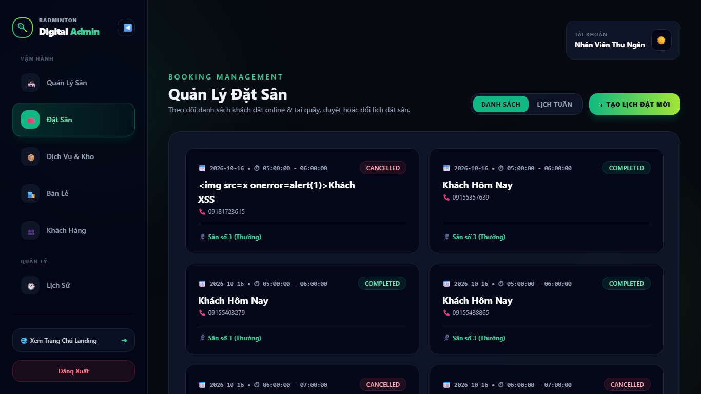
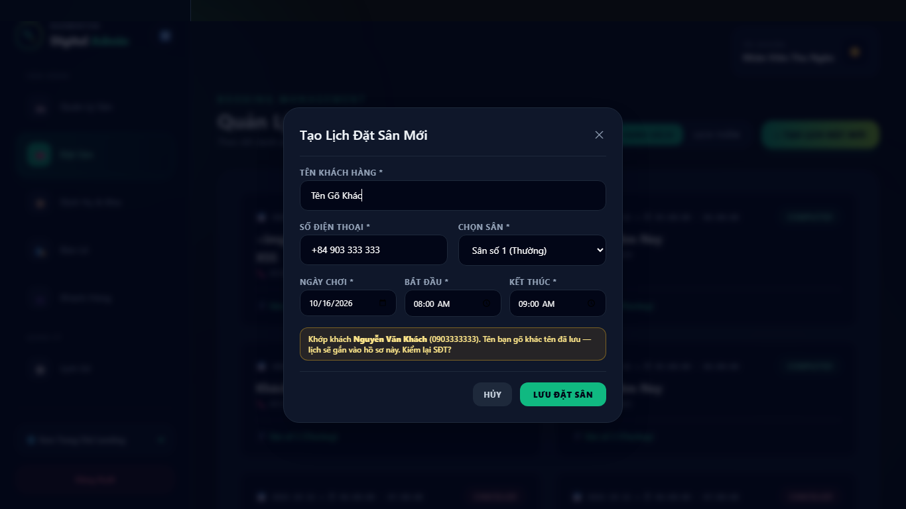
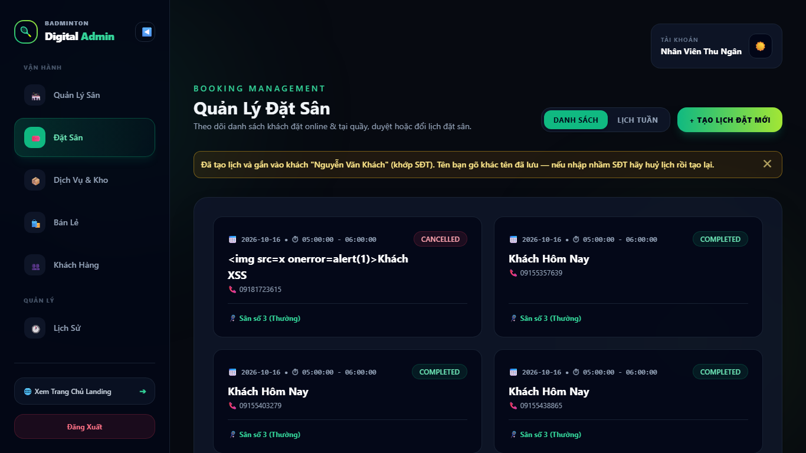
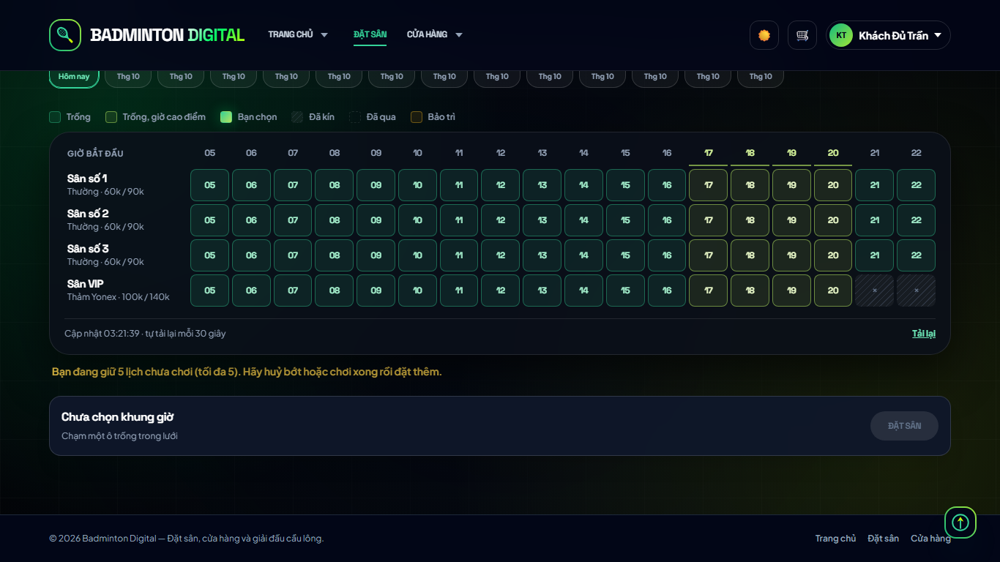

# Kết quả — kế hoạch 42 (F3, F4, F5, F6 của báo cáo 40)

**Ngày 2026-10-16 · nhánh `fix/flow-dat-san-f3-f6` · kế hoạch: [42](42-ke-hoach-sua-flow-dat-san-f3-f6.md) · nguồn: [báo cáo 40](40-ket-qua-kiem-thu-flow-dat-san.md)**
Duyệt theo đề xuất mặc định Q1–Q8. Chưa push, chưa merge `main`.

## 1. Đã làm gì

| Mục | Kết quả | Thay đổi chính |
|---|---|---|
| **F3a** trần lịch đang giữ | ✅ | Khách tối đa **5** lịch `pending`/`confirmed` chưa qua giờ kết thúc (mọi chi nhánh); đếm **trong** transaction SERIALIZABLE nên song song không lọt trần; nhân viên không bị; vượt → `400` kèm `code: BOOKING_LIMIT` |
| **F3b** tự huỷ `pending` quá hạn | ✅ | `BookingService.expireStalePendingBookings` trong vòng quét 5 phút của `server.js`; chỉ lịch **do khách tự đặt**; hạn `max(đặt+15p, min(đặt+24h, bắt đầu−60p))`; ghi `booking.expired` (không có user) + phát `booking:changed`. Nhân viên tạo thì không bao giờ tự huỷ. **Chưa có thông báo cho khách** (Q2: để việc riêng) |
| **F3c** giới hạn tần suất | ✅ | `POST /bookings`: 20 lượt / 10 phút **theo user**, chỉ vai khách (nhân viên `skip`) → `429` |
| **Cấu hình** | ✅ | Khoá cài đặt `booking_policy` `{ maxActivePerCustomer: 5, pendingExpiryHours: 24, pendingExpireBeforeStartMinutes: 60 }`, `0` = tắt từng luật; thêm vào `KNOWN_KEYS` + kiểm kiểu. **Chưa có màn hình Cài đặt** (sửa qua `PUT /settings`) |
| **F4** mở sân từ booking | ✅ (API) | Khác ngày hôm nay (theo múi giờ chi nhánh) → `400 BOOKING_WRONG_DAY` (chặn cứng, **không tạo phiên, booking giữ nguyên**); cùng ngày nhưng sớm hơn giờ bắt đầu >60 phút hoặc đã qua giờ kết thúc → `409 BOOKING_TIME_MISMATCH`, gửi lại kèm `acknowledgeTimeMismatch: true` thì mở (ghi cờ vào nhật ký). `errorHandler` trả thêm `code` ở cấp cao nhất cho lỗi có chủ đích |
| **F5** khớp SĐT khi đặt hộ | ✅ | Trước khi lưu: rời ô SĐT → tra `GET /customers?search=` → dòng "Khớp khách **X** (SĐT)", vàng + "Kiểm lại SĐT?" khi tên gõ khác. Sau khi lưu: phản hồi có `customerMatch { id, fullName, nameDiffers }` (chỉ nhân viên, không lưu DB) → banner xanh/vàng |
| **F6** trang nhân viên tự cập nhật | ✅ | `booking:changed { branchId, bookingId, status }` (không PII) sau mọi thao tác đặt/sửa/huỷ/duyệt/mở-sân-từ-lịch/tự huỷ; `BookingsPage` tải lại trang hiện tại, **hoãn khi đang mở form**, có dòng "đang kết nối lại…" |

### Lệch so với kế hoạch (nói thẳng)
1. **F4 — không có phần giao diện.** Khi đọc `CourtsPage` thấy UI **chưa bao giờ gửi `bookingId`** (chỉ mở sân theo tên khách vãng lai), nên không có chỗ để hiện hộp xác nhận. Chặn nằm ở API (cho mọi client/tích hợp); nếu sau này thêm nút "Mở sân từ lịch", giao diện chỉ cần bắt `409 BOOKING_TIME_MISMATCH` và gửi lại kèm cờ.
2. **Phát hiện và sửa thêm:** form "Tạo lịch đặt mới" lấy ngày mặc định bằng `new Date().toISOString()` → trong khoảng **00:00–07:00 giờ Việt Nam hiện ngày hôm qua** (lịch đã qua). Đổi sang `todayInZone(múi giờ chi nhánh)`; có ca kiểm W3a (chạy lúc ~03:00 giờ VN: form = hôm nay).
3. **`CourtsPage`** trước đây tải lại danh sách sân cho **mọi** sự kiện SSE; giờ chỉ với `court:updated` (vì stream nay còn mang `booking:changed`).
4. Bộ test bảo mật dùng `AuthService.register` trực tiếp thay vì route `/auth/register` (limiter 5 lần/giờ/IP làm file test cần nhiều khách mới bị 429).

## 2. Kiểm chứng

| Bộ kiểm | Kết quả |
|---|---|
| Backend `npm test` | 60 suite, **879/880 pass**; đỏ duy nhất `bcryptCompat.test.js` (node_modules của máy này còn bản cũ — đã ghi từ vòng bảo mật, cần `npm ci`; không liên quan) |
| Test mới backend | `bookingPolicy.test.js` (chính sách + `pendingExpiryAt` + `openWindowViolation`, kể cả biên múi giờ); `bookingAdvanceWindow.test.js` +2 ca trần |
| `npm run test:security` (DB tạm) | **7 suite, 135/135 pass** (+6): đủ 5 lịch → 400 `BOOKING_LIMIT`, huỷ 1 thì đặt lại được, nhân viên 6 lịch không bị; lượt 21 → 429, nhân viên không bị; sweeper huỷ lịch khách quá hạn nhưng **không** đụng lịch nhân viên tạo hay lịch còn hạn + log `booking.expired` user NULL; mở sân ngày khác → 400 không tạo phiên, lệch giờ 409 → 201 có cờ; `customerMatch` có/không; `booking:changed` đúng 3 khoá |
| Frontend Vitest | **510/510 pass** (+10: `phone.js`, 429/BOOKING_LIMIT của `bookingError`); `npm run build` OK |
| Chrome headless (server mã mới `:5062`, DB `bd_sectest_flow`) | **8/8**, 0 lỗi console — bảng dưới |

| Mã | Kiểm | KQ |
|---|---|---|
| W1 | Lịch do nơi khác tạo hiện trên `/bookings` của nhân viên **không tải lại trang** | ✅ |
| W2 | Đang mở form: không tải lại, giữ chữ đang gõ; đóng form → danh sách cập nhật | ✅ |
| W3a | Ngày mặc định của form = hôm nay theo giờ chi nhánh | ✅ |
| W3b | Gõ `+84 903 333 333` + tên khác → "Khớp khách Nguyễn Văn Khách (0903333333)… Kiểm lại SĐT?" | ✅ |
| W3c | Lưu → banner vàng nêu hồ sơ đã gắn | ✅ |
| W4 | SĐT mới → không có dòng khớp | ✅ |
| W5 | Khách đủ 5 lịch đặt thêm trên `/dat-san` → POST 400, trang hiện "Bạn đang giữ 5 lịch chưa chơi (tối đa 5)…" | ✅ |

### Ảnh chụp

Thư mục `docs/05-extra/02-remediation/42-anh/` (laptop 1366×768 trừ khi ghi *điện thoại*).

| Ảnh | Nội dung |
|---|---|
|  | **W1** Trang nhân viên tự hiện lịch mới do nơi khác tạo, không tải lại |
|  | **W3b** Gõ SĐT khách có sẵn + tên khác → dòng "Khớp khách … Kiểm lại SĐT?" |
|  | **W3c** Sau khi lưu → banner vàng nêu hồ sơ đã gắn |
|  | **W5** Khách đủ 5 lịch đặt thêm → "Bạn đang giữ 5 lịch chưa chơi (tối đa 5)…" |

## 3. Còn lại / nên biết

- **Khách không được báo** khi lịch bị tự huỷ (chưa có kênh email/SMS) — họ chỉ thấy "Đã huỷ" trong Lịch của tôi. Nếu bạn muốn hạn 24 giờ nhưng khách cần biết, nên làm thông báo trước khi bật rộng.
- **Công tắc nhanh:** đặt `pendingExpiryHours = 0` trong `booking_policy` để tắt hẳn tự huỷ; `maxActivePerCustomer = 0` để bỏ trần.
- **Đơn tiến trình:** `booking:changed` dùng `realtimeBus` trong bộ nhớ — chỉ đúng khi chạy **một** tiến trình backend (đúng Render/compose hiện nay; ghi chú đã có trong `realtimeBus.js`).
- Toàn bộ F1–F11 của báo cáo 40 giờ đã xử lý hoặc ghi nhận có chủ đích (F9).
- Môi trường tạm `:5060` (mã cũ) và `:5062` (mã mới) + DB `bd_sectest_flow` **đang được giữ** đến khi bạn bảo dọn (Q8).
