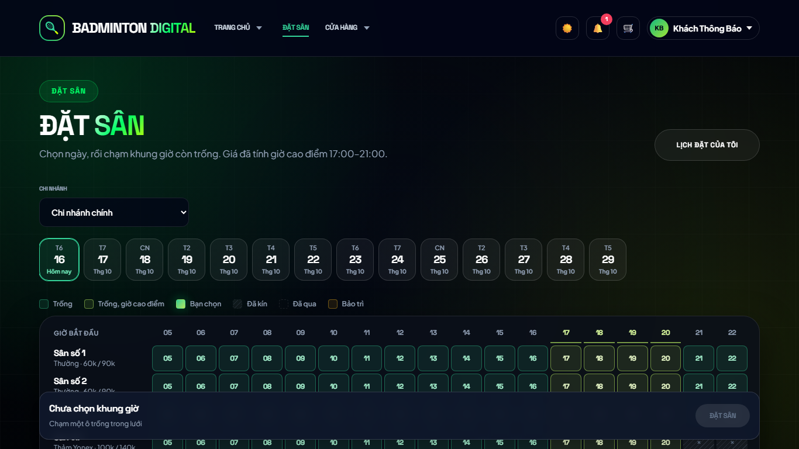
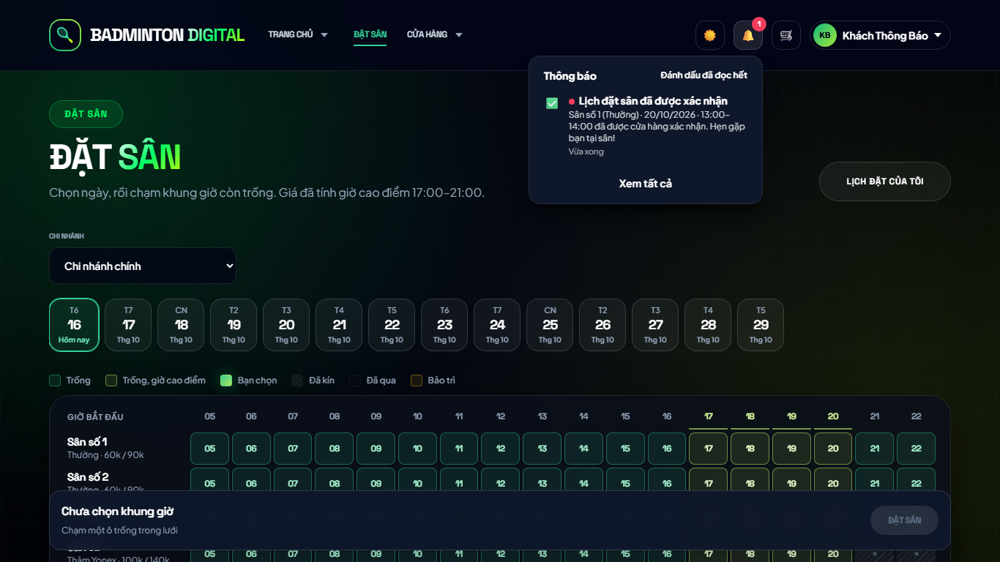
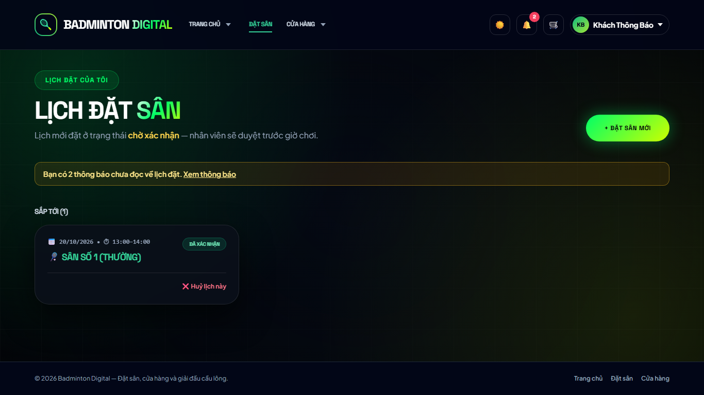
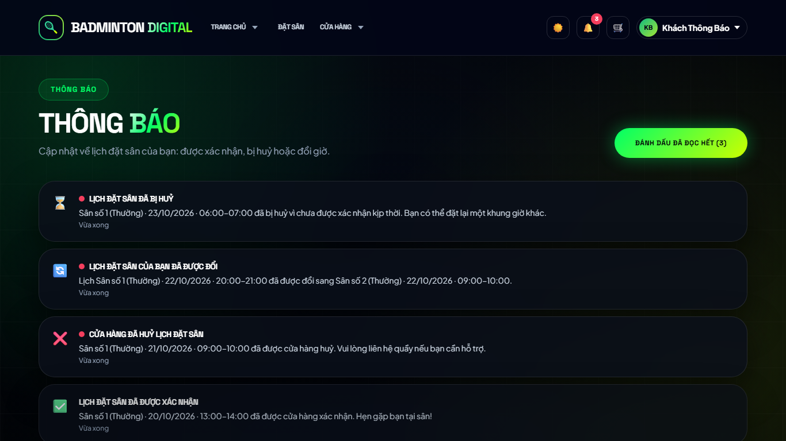
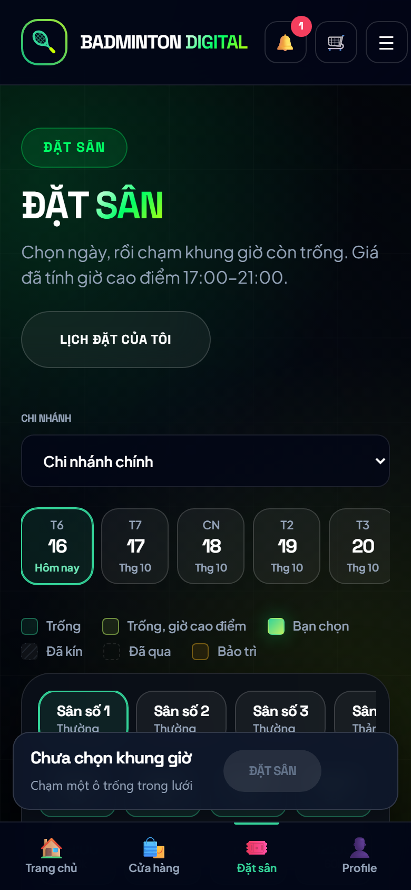
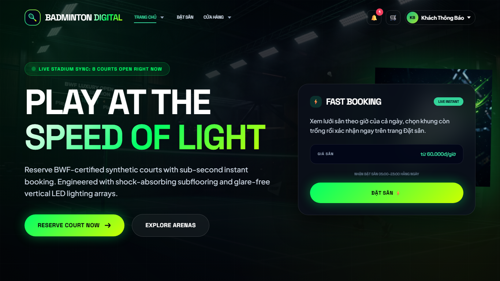

# Kết quả — kế hoạch 43 (thông báo cho khách)

**Ngày 2026-10-16 · nhánh `feat/thong-bao-khach` · kế hoạch: [43](43-ke-hoach-thong-bao-khach.md)**
Duyệt theo đề xuất mặc định Q1–Q8. Chưa push, chưa merge `main`.

## 1. Đã làm gì

| Phần | Kết quả |
|---|---|
| **Dữ liệu** | Migration `20261016100001-create-customer-notifications` (bảng `customer_notifications`, chỉ mục hộp thư `(customer_id, read_at, created_at)` + `created_at`), model `CustomerNotification`. **Cần `npm run migrate`** |
| **Sự kiện** | Duyệt (`booking.confirmed`) · tự huỷ quá hạn (`booking.expired`) · nhân viên huỷ (`booking.cancelled_by_staff`) · nhân viên đổi sân/ngày/giờ (`booking.rescheduled`, nêu cả khung cũ và mới). Khách tự huỷ → **không** báo; sửa mà không đổi sân/ngày/giờ → không báo; khách không tài khoản → không có nơi để báo |
| **Tính nhất quán** | `NotificationService.notifyBooking` chạy **trong cùng transaction** với đổi trạng thái: ghi thông báo lỗi → lịch không đổi (có test) |
| **Email (cộng thêm)** | Mẫu mới `sendBookingNotificationEmail`; gửi **sau commit**, không chặn, nuốt lỗi + log; chỉ khi có SMTP, khách có email và `notification_policy.email` ≠ `false` (khoá cài đặt mới, kiểm kiểu boolean) |
| **API** | `GET /notifications` (+`limit` 1–50, `unread=true`, trả `unreadCount`), `PUT /notifications/:id/read`, `PUT /notifications/read-all`; chỉ vai `customer`, chỉ của chính mình. Postman thư mục `25 · Notifications`, `docs:build` 118/118 route khớp |
| **Dọn dẹp** | `purgeOld` trong vòng quét 5 phút: đã đọc > 30 ngày, mọi thông báo > 90 ngày |
| **Giao diện** | Chuông trong header chung **chỉ cho vai khách** (bảng thả xuống 8 thông báo + "Đánh dấu đã đọc hết" + "Xem tất cả" ở máy tính; liên kết `/notifications` trên thanh 80 px điện thoại); trang `/notifications`; mục "Thông báo" trong menu tài khoản; dòng nhắc ở "Lịch của tôi". Cập nhật bằng polling 60 s + khi quay lại tab + khi điều hướng (không SSE cho khách) |

## 2. Kiểm chứng

| Bộ kiểm | Kết quả |
|---|---|
| Backend `npm test` | 61 suite, **886/888**; đỏ: `bcryptCompat` (node_modules cũ của máy này) và 1 ca flaky `competitionGateway` đã biết từ trước |
| Test mới backend | `notificationMessages.test.js` (8 ca: nội dung, đổi lịch nêu khung cũ/mới, loại lạ ném lỗi, `notification_policy`) |
| `npm run test:security` (DB tạm) | **7 suite, 143/143** (+8): duyệt → 1 thông báo chưa đọc → đọc → 0; nhân viên huỷ có / khách tự huỷ không; đổi giờ nêu cả hai khung, sửa không đổi gì không báo; sweeper → `booking.expired`; khách vãng lai không có dòng nào + không chứa email nhân viên/SĐT; **IDOR** (B không đọc/đánh dấu của A → 404, nhân viên/quản lý/admin → 403, không token → 401, `limit=500`/`id=abc` → 400, `read-all` chỉ của mình); lỗi ghi thông báo → lịch giữ `pending`; `notification_policy.email` phải boolean |
| Frontend Vitest | **529/529** (+19: `notificationView`, SSR `NotificationBell` + `SiteHeaderView`, menu tài khoản); `npm run build` OK |
| Chrome headless (server mã mới `:5062`, DB tạm) | **8/8**, 0 lỗi console — bảng dưới |

| Mã | Kiểm | KQ |
|---|---|---|
| X1a | Nhân viên duyệt → chuông có chấm "1", bảng có "Lịch đặt sân đã được xác nhận" kèm sân/ngày/giờ | ✅ |
| X1b | Bấm thông báo → về `/my-bookings`, `PUT …/read` 200, chấm biến mất | ✅ |
| X2 | Nhân viên huỷ + đổi giờ → quay lại tab: chấm "2" (không tải lại trang), `/my-bookings` có dòng nhắc | ✅ |
| X3 | Lịch pending quá hạn bị sweeper huỷ → `/notifications` có "chưa được xác nhận kịp thời", "cửa hàng huỷ", "được đổi" | ✅ |
| X4 | "Đánh dấu đã đọc hết" → chấm biến mất, DB không còn dòng chưa đọc | ✅ |
| X5 | Điện thoại 390 px: chuông trong thanh trên, bấm tới `/notifications`, không cuộn ngang | ✅ |
| X6 | Trang chủ (header kính tối) có chuông cho khách; **nhân viên đăng nhập không có chuông** | ✅ |

### Ảnh chụp

Thư mục `docs/05-extra/02-remediation/43-anh/` (laptop 1366×768 trừ khi ghi *điện thoại*).

| Ảnh | Nội dung |
|---|---|
|  | **X1a** Nhân viên duyệt → chuông có chấm đỏ "1" |
|  | **X1a** Bấm chuông → bảng thông báo (sân, ngày, giờ, "Vừa xong") |
|  | **X2** Nhân viên huỷ + đổi giờ → chấm "2" khi quay lại tab, không tải lại |
|  | **X3** Trang `/notifications` (kể cả lịch tự huỷ quá hạn) |
|  | **X5** *Điện thoại* — chuông trên thanh 80 px |
|  | **X5** *Điện thoại* — trang thông báo |
|  | **X6** Trang chủ (header kính tối) có chuông cho khách |

### Lỗi tự bắt được khi chạy thật (đã sửa)
1. **Chuông không hết chấm sau khi bấm thông báo:** bấm vừa đánh dấu đọc vừa chuyển trang; header cũ bị huỷ, header mới hỏi server **trước khi** PUT xong → hiện lại số cũ. Sửa: sau PUT phát sự kiện cửa sổ `bd:notifications-changed` để mọi bản header đang sống hỏi lại.
2. **Trang `/notifications` đánh dấu đọc nhưng chuông ở header giữ số cũ:** cùng cơ chế sự kiện trên.
3. **Dòng nhắc ở `/my-bookings` bị lỗi thời** khi thông báo đến lúc đang ở trang: header phát `bd:notifications-count` mỗi lần hỏi, trang lắng nghe.

## 3. Việc phụ phải làm để bộ test không vỡ
- `tests-security/group-d` (R15, "khách đặt đúng 3 giờ"): trước đây dò mù bằng POST; nay có giới hạn 20 lượt/10 phút (kế hoạch 42) nên dò dày sẽ dính 429 → đổi sang chọn khung 3 giờ trống từ lưới công khai rồi đặt một lần. Cùng cách đó đã được áp cho `tryBook` của `booking-flow`.

## 4. Còn lại / nên biết
- **Không có SMS/Zalo/push** (chưa có nhà cung cấp) — khách không có tài khoản vẫn không được báo.
- Email chỉ đến được khách **có email** và khi vận hành **đã cấu hình SMTP** (bản demo Render chưa có) — chuông là kênh chính.
- Không có tuỳ chọn tắt/bật từng loại thông báo; chỉ có công tắc email `notification_policy.email` (qua `PUT /settings`, chưa có màn hình).
- Môi trường tạm `:5060` (mã cũ, **chưa có bảng mới**) và `:5062` (mã mới) + DB `bd_sectest_flow` **đang được giữ** tới khi bạn bảo dọn.
